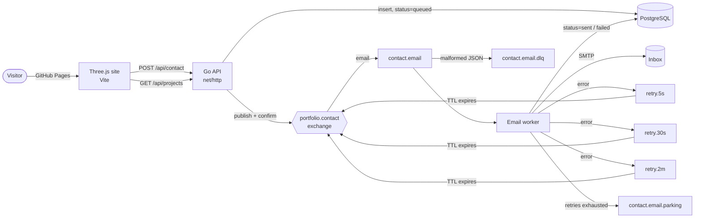

<p align="center">
  
</p>

<p align="center">
  <a href="https://razi-king.github.io/Portfolio/"></a>
  <br/>
  <a href="https://github.com/razi-king/Portfolio/actions/workflows/backend.yml"></a>
  <a href="https://github.com/razi-king/Portfolio/actions/workflows/pages.yml"></a>
  
  
  
  
</p>

My personal portfolio. A 3D globe shows flight routes out of Mumbai, because that's my day job: I connect airlines to booking engines in Go. Behind the site is a small production-style Go backend. Contact messages go through **PostgreSQL → RabbitMQ → an email worker**, with timed retries, a dead-letter queue and a parking-lot queue.

## Architecture



### What's in the backend

| Concern | How it's handled |
|---|---|
| **Delivery guarantees** | Publisher confirms on every publish; manual acks; a job is acked only after it has been sent or safely rescheduled |
| **Retries** | One durable retry queue per delay (5s, 30s, 2m) with a TTL that dead-letters back to the main queue. Fixed-delay queues avoid the head-of-line blocking you get with per-message TTLs |
| **Poison messages** | Malformed payloads are rejected straight to the DLQ; jobs that exhaust their retries go to a parking-lot queue for inspection |
| **Status tracking** | Each message moves `queued → sent` or `queued → failed` in Postgres, with attempts and the last error |
| **Abuse protection** | Per-IP token-bucket rate limiting, a honeypot field, a 16 KB body limit, strict JSON decoding, and header-injection checks |
| **Resilience** | Panic-safe goroutines (`safego.Go`), panic-recovery middleware, consumer reconnect with backoff, graceful shutdown |
| **Zero-infra mode** | With no `DATABASE_URL` / `AMQP_URL`, it falls back to in-memory storage and an in-memory queue that use the **same retry policy** |
| **Single source of truth** | `projects.json` is embedded in the Go binary *and* imported by the frontend at build time |

```
backend/
├── cmd/server        API (+ in-process worker when RUN_WORKER=true)
├── cmd/worker        standalone worker for separate scaling
├── internal/contact  validation, service, Postgres + memory repositories, HTTP handler
├── internal/queue    RabbitMQ topology & consumer, memory queue, shared retry policy
├── internal/worker   turns jobs into emails, records outcomes
├── internal/mailer   SMTP (STARTTLS) and log-only mailers
├── internal/httpx    middleware: request ID, logging, recover, CORS, security headers, rate limit
├── internal/projects embedded project catalogue + GET /api/projects
└── integration_test.go  end-to-end against real Postgres + RabbitMQ (runs in CI)
```

## API

| Method | Path | Description |
|---|---|---|
| `GET` | `/healthz` | Liveness |
| `GET` | `/readyz` | Readiness (pings the database) |
| `GET` | `/api/projects?category=frontend` | Project catalogue |
| `POST` | `/api/contact` | `{name, email, subject?, message}` → `202 {id, status: "queued"}`, `422` with field errors, `429` when rate-limited |

## Run it locally

```bash
# Backend with zero setup (in-memory DB + queue, emails are logged)
cd backend && go run ./cmd/server

# Full stack: API + worker + Postgres + RabbitMQ (management UI on :15672)
cd backend && docker compose up --build

# Frontend
cd frontend && npm install
VITE_API_URL=http://localhost:8080 BASE_PATH=/ npm run dev
```

Tests:

```bash
cd backend
go test -race ./...                                   # unit tests
DATABASE_URL=... AMQP_URL=... go test -tags integration -v .   # end-to-end
```

## Deploy (all free tiers)

| Piece | Where |
|---|---|
| Frontend | GitHub Pages, deployed by `.github/workflows/pages.yml` on every push |
| Go API + worker | Render (Docker) via `render.yaml` |
| PostgreSQL | Neon |
| RabbitMQ | CloudAMQP, Little Lemur plan |

1. **Pages:** Settings → Pages → Source: **GitHub Actions**.
2. **Database:** create a Neon project and copy the connection string.
3. **Queue:** create a CloudAMQP *Little Lemur* instance and copy its AMQP URL.
4. **API:** Render → New → Blueprint → this repo. Fill in `DATABASE_URL`, `AMQP_URL`, `SMTP_USER` and `SMTP_PASS` (a Gmail app password).
5. **Connect them:** in this repo, go to Settings → Secrets and variables → Actions → Variables and add `API_URL` = your Render URL. Then re-run the Pages workflow.

---

<p align="center">Built by <a href="https://github.com/razi-king">Razi King</a> 👑</p>
